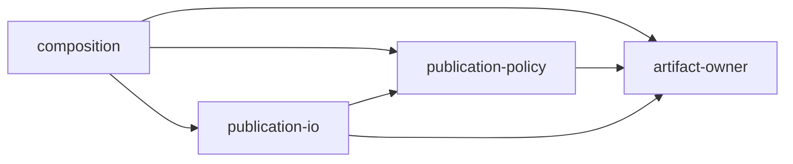

# Module Boundary Rules

Treat public APIs, package ownership seams, modules, source sets, services,
repositories, controllers, queues, adapters, generated-code handoffs, persistence
records, and DTO-to-domain conversions as boundaries.

## Hard Rules

- Preserve established facts in boundary signatures or schemas.
- Parse primitive inputs before passing them deeper than the owning adapter.
- Return named domain values, closed outcomes, capabilities, state-specific
  values, or collections whose elements preserve meaning.
- Keep transport DTOs at the outer edge and make conversion explicit.
- Do not require callers to remember private control flow, prior validation,
  comments, or call order.
- Do not expose untyped maps, universal values, primitive statuses, ambiguous
  nulls, or a primitive plus a prose list of allowed values as domain results.

Transport protocols may require primitive encodings. Keep that extraction in
the owning adapter, validate the serialized contract, and require stronger
representations at the application interfaces on each side. A transport
requirement does not justify primitive domain contracts or repeated guards
inside application layers.

## Modules As A Proof Boundary

A module can own both a fact's representation and the transition that establishes
it. Other modules receive the stronger value through its public API; they cannot
call its private constructor or Kotlin `internal` construction helpers. A package
name alone does not provide that boundary: `internal` applies to the compilation
module, and friend modules remain trusted callers.

Consider splitting the [artifact example](kotlin-proof-example.md) into the
following modules. This is an illustrative layout; the bundled executable example
currently compiles the domain and output adapters together, then compiles consumers
separately.

| Module | Owns | Production project dependencies |
| --- | --- | --- |
| `artifact-owner` | Immutable bytes, digest parsing, verification, and controlled construction of `VerifiedArtifact` | None |
| `publication-policy` | Pure preparation of `PublicationRequest` from `VerifiedArtifact` | `artifact-owner` |
| `publication-io` | Output adapters and external publication | `publication-policy`, `artifact-owner` |
| `composition` | Acquisition and wiring of the legal path | All three |



Each arrow means "depends on." `publication-policy` acts as a buffer: it can
prepare a request using established verification, while its dependency closure
contains no publication implementation. `artifact-owner` cannot depend on the
policy or publication modules. The composition module connects them through
their public contracts.

The value flow carries a different direction of knowledge:

```text
UnverifiedArtifact -> Verification.Verified -> VerifiedArtifact -> PublicationRequest
```

`PublicationRequest.prepare` requires `VerifiedArtifact`, so raw bytes, a digest
string, or `UnverifiedArtifact` cannot substitute for the established checksum
match. The request retains that verified artifact. Preparation establishes a
request, and publication must establish its own effect outcome.

When separating output adapters, preserve controlled access to immutable
snapshots at the owning output boundary. The current adapters use `internal`
storage access and cannot simply move into another compilation module. Do not
make storage or unchecked construction public to accommodate the split.

## What Each Boundary Establishes

- Private and module-scoped construction restrict who can mint the stronger value.
- Consumer signatures require the fact and retain it through the next transition.
- An excluded module in the complete production dependency closure makes that
  module's capability unavailable to the consumer. Check transitive dependencies
  and exported APIs; omitting a direct dependency alone is insufficient.
- A repository dependency check can reject later edges that would remove the
  exclusion. Compile a consumer separately to check visibility and type misuse.

Module names and a diagram do not establish these facts. Verify the actual build
graph and public APIs. Standard-library I/O, effects inside external libraries,
reflection, and runtime freshness require their own boundaries and evidence;
excluding `publication-io` alone does not prove general purity.
