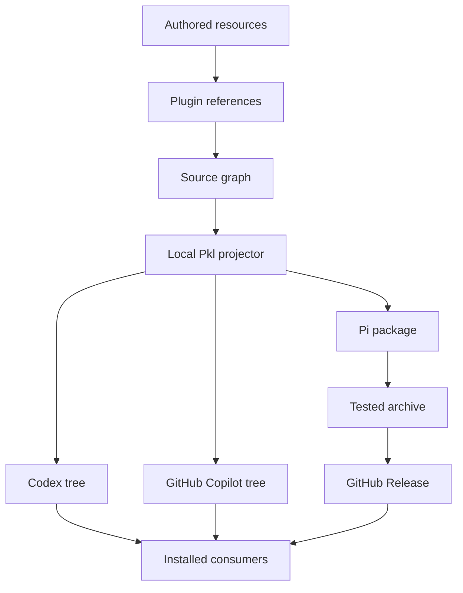

Slopsentral keeps one authored source for each reusable resource.
Plugin manifests compose those resources by reference.
The local Pkl projector produces provider-specific trees.

The diagram shows ownership and delivery order.
It does not record an installed host result.

## Authoritative files

| Path | Owner |
| --- | --- |
| `source/adaptable.marketplace.json` | Marketplace identities and references |
| `source/plugins/*/plugin.json` | Plugin composition |
| `source/skills`, `source/agents`, `source/hooks` | Authored procedures, agents, and hooks |
| `source/concepts`, `source/profiles`, `source/evals`, `source/schemas` | Knowledge, selections, fixtures, and contracts |
| `source/instructions` | Shared policies |
| `tools` | Repository maintenance and projection |
| `docs/public` | Authored Mintlify pages and navigation |

`source/CATALOG.md` is generated from the manifests.
It describes their current selection.
The manifests remain the composition authority.

## Generated consumers

Codex receives `.agents/plugins`.
GitHub Copilot receives `.github/plugin`.
Publication updates both trees on `main` and their provider branches.

Pi receives `.pi/slopsentral` through projection.
Releases promote a tested archive with its candidate and promotion records.
The [Pi guide](/guides/pi) describes package ownership and release evidence.

Installed caches under `~/.codex/plugins/cache` remain consumers.
Do not change generated trees or installed caches as authored source.
A local projection does not publish a branch or refresh an installation.

## Proof limits

The graph rejects conflicting identities, missing paths, cycles, and duplicate hook selection in a profile.
Projection establishes output bytes and provenance for supported provider shapes.
Neither result proves hook consumption or model behavior.

The [repository architecture](/reference/architecture) gives the complete contract.
The [projection procedure](/maintainers/projection) describes the supported local path.
