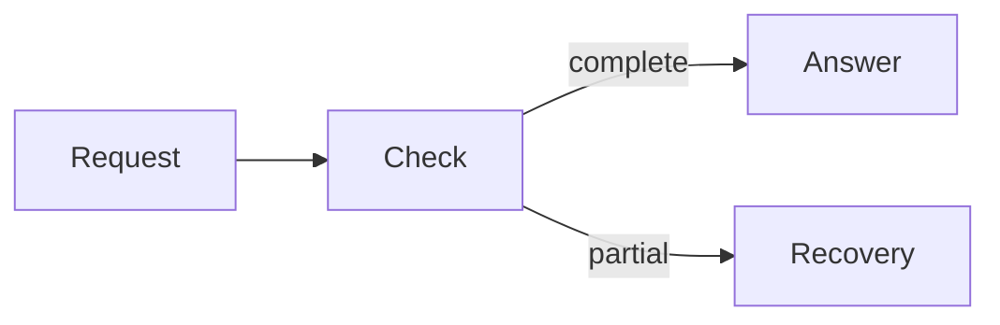

# Documentation evidence fixture

This is synthetic input for seven bounded documentation cases. It is not a
description of a real product. Preserve this file during a replay.

## Source identity

Repository: `example/query-tool`. Selected worktree revision: `bbbbbbbb`.
The supplied export and its citations identify revision `aaaaaaaa`.
Inspect the registry artifacts and diff below before updating a claim.
The command registry owns defaults. A matching filename and a recent export
date do not remove this revision mismatch.

## Registry snapshots

These are synthetic `command-registry.json` artifacts from the two revisions.
They are source inputs, not observed command output.

```json command-registry@aaaaaaaa
{
  "commands": {
    "query": {
      "parameters": {
        "limit": {
          "type": "integer",
          "default": 30,
          "minimum": 1,
          "maximum": 100
        }
      }
    }
  }
}
```

```json command-registry@bbbbbbbb
{
  "commands": {
    "query": {
      "parameters": {
        "limit": {
          "type": "integer",
          "default": 60,
          "minimum": 1,
          "maximum": 100
        }
      }
    }
  }
}
```

Their source diff:

```diff
@@ -4,7 +4,7 @@
       "parameters": {
         "limit": {
           "type": "integer",
-          "default": 30,
+          "default": 60,
           "minimum": 1,
           "maximum": 100
         }
```

## Export and live inventory

Both inventories list page IDs `start`, `execution`, and `limits`.
The export includes only diagram `execution-1`.
The live inventory includes `execution-1` and `limits-1`.
The export's three matching page IDs therefore leave one diagram missing.
No live runtime test or architecture review has been supplied.

Exact recovered `execution-1` source:



Exact recovered `limits-1` source, which the renderer rejects:

```text
flowchart LR
  Limit[Budget --> Stop
```

Preserve both originals. A repaired render of `limits-1` needs a separate source
file and a recorded syntax correction. Removing the partial branch from
`execution-1` changes its meaning.

## Site ownership

The site uses Mintlify `docs.json` and hosted MDX. Its command registry generates
`reference/commands.mdx`; that page carries a generated marker. The page claims
the old limit of 30. `architecture/execution.mdx` explains query completion.
`guides/first-query.mdx` owns the first-result procedure. No request authorizes
deployment or installing software on the host. The hosted renderer forbids
third-party npm imports and supports build-time assets.

## Proposed MDX

The proposed guide fragment contains an unsupported import and a hidden caveat:

```mdx
import { renderMermaidSVG } from 'beautiful-mermaid';

<Accordion title="Details">
  Partial evidence does not prove that the query covered all declarations.
</Accordion>

<Prompt>Find the callers of demo.</Prompt>
```

## Renderer observations

A successful build and a successful XML parse are supplied.
At 1440 px in light mode the standalone SVG shows all four nodes.
At 375 px in dark mode the page screenshot shows an empty diagram panel.
The SVG contains an external font `@import`.
The copied prompt before hydration is empty; after hydration it is
`Find the callers of demo.\n`. Its final LF is literal clipboard data.
The mobile menu remains open after the second page navigation.
No keyboard or screen-reader check has been supplied.

## Compact task

Write one first-query guide, using only these facts.
The reader has installed the tool and connected an agent. The known declaration
is `demo`. A useful result contains its signature and source location.
The reader then asks for callers. Partial evidence requires a narrower retry;
an empty result does not prove absence. Link the exact contract from Reference
and the mechanism from Architecture. Do not invent installation commands.
